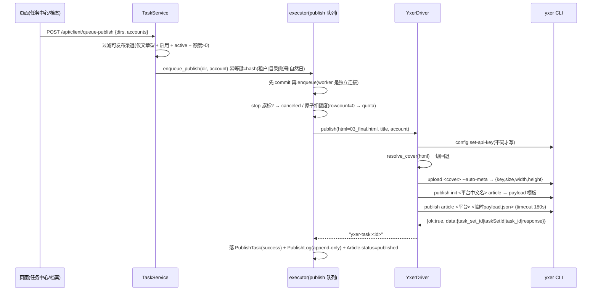

# 蚁小二（yxer）发布功能 · 全链路说明

> 适用代码：`article-pipeline/app/services/publish/*`、`app/services/douyin_*.py`、`app/blueprints/{distribution,generation}/*`
> 本文把「文章发布 → 抖音图文发布 → 短视频发布」这一套经蚁小二分发的内容生产到落地，整理成可实现的流程 + 注意事项。
> 所有结论均来自当前代码，注释里的 `实测` 均为真实联调记录。

---

## 1. 一句话架构

系统**不直接对接各内容平台**，而是把内容交给本机安装的蚁小二 CLI（`yxer`），由蚁小二的云端账号库完成平台登录态与投递：

```
本系统（内容 + 封面/配图 + 账号选择 + 额度 + 幂等）
        │  ① 写 API Key 到 ~/.yxer/config.json
        │  ② yxer upload      上传图片/视频素材 → 拿 key
        │  ③ yxer publish init <平台> <类型>   取平台官方 payload 模板
        │  ④ 填充模板 → 临时 JSON → yxer publish <类型> <平台> <file>
        ▼
   蚁小二 CLI  →  蚁小二云  →  各平台（搜狐/百家/头条/网易/知乎/抖音…）
        │
        └─ 返回 task_set_id（异步任务集）→ 本系统 `yxer-task:<id>` → 定时回查确认
```

三条产线共用同一套 CLI 出口，只在 **payload 类型**上分叉：

| 产线 | 驱动 | CLI 类型 | 入口 |
|---|---|---|---|
| 文章 | `YxerDriver`（`services/publish/yxer.py`） | `article` | 任务中心/档案页「发布」 |
| 抖音图文 | `YxerImgtextDriver`（`services/publish/yxer_imgtext.py`） | `imageText` | 抖音图文页「发布」 |
| 短视频 | `YxerVideoDriver`（`services/publish/yxer_video.py`） | `video` | 短视频页「发布」 |

> 另一条平行通道是 Playwright 本地驱动（美篇/搜狐/百家号/列表网/58），账号**没绑蚁小二**时才走它。
> 判定唯一入口：`Account.yxer_id` 非空 → 蚁小二；为空 → 本地驱动（`executor._yxer_driver`）。

---

## 2. 前置条件（部署前必须一次做对）

### 2.1 安装 CLI

```bash
npm install -g @yixiaoermail/cli
yxer --version            # 能打印版本号才算装好
yxer config set-api-key <你的API Key>
yxer doctor               # 官方自检
```

- Windows 下 npm 全局 shim 是 `yxer.cmd`，代码里 `cli_exe()` 同时找 `yxer` / `yxer.cmd`。
- **不要在程序里自己拼 HTTP 请求**：这套集成是 CLI 模式，`base_url` 等旧 HTTP 字段仅为兼容保留，不参与判定。

### 2.2 API Key 的存放与生效

| 项 | 说明 |
|---|---|
| 系统内配置 | `data/model_config.json` 的 `yxer` 段：`{"token": "<API Key>", "use_mock": false}` |
| 配置页 | 系统设置页（`client_settings.html`）填 Key + 「测试连接」→ `POST /api/model-config/test-yxer` |
| CLI 实际读取 | **只认 `~/.yxer/config.json`**（环境变量 `YIXIAOER_API_KEY` 实测无效） |
| 切换 Key | 每次发布前 `sync_api_key()` 比较后写入（不同才写）→ **改 Key 即时生效，无需重启** |
| 换 Key 的副作用 | Key = 账号库。旧 Key 下的云账号 id 在新库里查不到，会自动被剔出发布池（本地 Account 行保留，历史发布记录不断） |

「测试连接」用**临时 HOME** 跑一次 `accounts list --json`（临时目录里写一份无 BOM 的 `config.json`），**不碰真实 CLI 配置**，测试失败不会破坏线上可用状态。

### 2.3 演示模式（`use_mock`）

勾选后所有驱动返回确定性假链接（`https://mock-yxer.example.com/...`），账号库返回 7 个假抖音/搜狐/百家号账号。
用途：无 Key 时演示整条链路。**它不会真的发出去**，日志与页面必须能看出这是演示，不能当成功汇报。

---

## 3. CLI 桥接层（`services/publish/yxer_cli.py`）

所有与 CLI 的交互都收敛在 `run_yxer()`，这是可复用实现的核心。

### 3.1 输出契约

CLI 每条命令都输出严格 JSON 信封：

```json
{"ok": true,  "data": …}
{"ok": false, "error": {"code": "YIXIAOER_AUTH_ERR", "category": …, "message": …, "hint": …, "details": …}}
```

**实测关键点（不做会 100% 误判）**：

1. 每条命令都必须追加 `--json`。
2. **成功信封走 stdout（rc=0），错误信封走 stderr（rc=2）** —— 只解析 stdout 会把所有失败误判成「输出非 JSON」。正确做法：先解 stdout，失败再解 stderr。
3. `error.details` 里是逐字段 schema 违规原因，必须拼进错误文本，否则只看到「Schema validation failed」等于没信息。

### 3.2 错误码归一

| 蚁小二错误码 / 特征 | 归一为 | 后果 |
|---|---|---|
| `YIXIAOER_AUTH_ERR`、账号不存在/不在线/离线/未登录 | `login_expired` | 账号标记 `invalid`，等重新授权 |
| `YIXIAOER_ENV_ERR`（二进制缺失/环境问题） | `timeout` | 不冻结账号，可重试 |
| `YIXIAOER_REMOTE_ERR` / `YIXIAOER_INTEGRITY_ERR` | `upstream` | 上游/校验问题 |
| 文本含 熔断/限流/风控 | `rate_limited` | 账号标记 `frozen` |
| 其它 | `unknown` | 如实回显原文 |

值域与 `models/publish.py:ERROR_CODES` 逐字对齐：`rate_limited / login_expired / quota / captcha / timeout / upstream / unknown`。

### 3.3 平台名映射

CLI 的 `publish` / `publish init` 都吃**平台中文名**，本系统内部用英文短码，靠 `_PLATFORM_CN` 双向映射：

- 文章型（20 个）：搜狐号、百家号、头条号、网易号、知乎、简书、大鱼号、一点号、企鹅号、新浪微博、豆瓣、CSDN、哔哩哔哩、AcFun、爱奇艺、车家号、易车号、雪球号、快传号、微信公众号
- 图文/视频型：抖音（内部码 `douyin` / `douyin_imgtext`）
- **美篇 / 列表网 / 58 同城不在蚁小二目录**，绑了蚁小二也会如实报错 —— 这三个只能走本地 Playwright 驱动。

---

## 4. 文章发布链路

### 4.1 时序



### 4.2 任务状态机与幂等（`executor.py`）

```
queued → running → success | failed
             ↘ canceled（批次暂停命中）
```

- **幂等键**：`sha1(tenant|article_dir|account_id|yyyy-mm-dd)`，唯一约束 `uq_ptask_tenant_idem`。
  同文章、同账号、同自然日只会存在一条任务 —— **重复发布 = 事故**。
- 命中已存在的任务时：`success` 原样复用；`failed/canceled/dead` 复位为 `queued` 重投（否则用户当天没有重试入口）。
- **额度**：单条 SQL `Account.quota_update_sql()` 一步完成「跨日重置 + 校验 + 自增」，`rowcount=0` 即额度耗尽。绝不先 SELECT 再 UPDATE（并发会超发）。额度按「尝试」扣，成功失败都算一次。
- **暂停**：任务中心 `POST /api/tasks/stop` 置内存旗标，排队任务直接落 `canceled`（页面按失败展示，原因写「已取消」）。
- **失败归因**：`rate_limited → 账号 frozen`，`login_expired → 账号 invalid`；其余只记日志不冻号。
- **日志**：每次发布无论成败都写一条 `PublishLog`（append-only 事实表）。任务中心内存日志只留最近 120 行且带 `[HH:MM:SS]` 前缀（页面用正则取时间）。

### 4.3 payload 组装（`yxer._fill_payload`）—— 最容易踩坑的一步

原则：**以 CLI 返回的平台模板为底，只填业务字段，平台差异字段保留模板默认值。**

```jsonc
{
  "platforms": ["百家号"],                  // 中文名
  "desc": "正文去标签前 200 字",           // ★ 只有模板本来有 desc 才回填
  "publishArgs": {
    "cover": { "key": "...", "size": 1, "width": 800, "height": 450 },  // preflight 要完整对象
    "coverKey": "...",
    "content": "<p>正文 HTML</p>",          // 文章正文走 content
    "accountForms": [{
      "platformAccountId": "<Account.yxer_id>",   // 云账号 id，不是本系统主键
      "contentPublishForm": {
        "title": "标题（≤30 字）",
        "desc": "…",                        // ★ 同样只在模板有该字段时写
        "covers": [{ "key": "...", "size": 1, "width": 800, "height": 450 }]
      }
    }]
  }
}
```

**必须记住的三条 schema 规则**：

1. **strict schema 不接受凭空字段**：头条号的 `contentPublishForm` 是 `additionalProperties: false`，硬塞 `desc` 会 `Schema validation failed`。所以 `desc` 只在 `"desc" in payload/cpf` 时回填。
2. **`covers` 每项必须有 `key/size/width/height`**；`cover` 是完整上传资源对象，`coverKey` 是它的 `key`。三者缺一都会被 preflight 拦。
3. **资源必须经 `yxer upload` 拿到 key**，严禁直接引用外部 URL（外链会过期，且蚁小二不认）。

### 4.4 封面三级回退（`yxer_cover.resolve_cover`）

文章型平台**强制封面**，所以这里保证「必返回一个存在的文件」：

1. 正文第一张内嵌配图 `` → 映射到租户本地文件；
2. 素材库首图（`Asset.kind == "image"`）；
3. 内置纯色 PNG 800×450（`zlib + struct` 手写生成，零第三方依赖，不写字、不做视觉承诺）。

> 路径解析必须校验：只接受 `assets/<file>` 两段，越界返回 None 走下一级，防止拼路径穿越。

### 4.5 标题长度

- 生成侧：`writer/title_context.shortify(title, 30)` —— 按「问号 → 冒号 → 分句 → 硬截断」智能压缩，**不用省略号结尾**（平台判定标题不完整）。
- 发布侧最后兜底：`cpf.title = shortify(title, 30)[:30]`。
- 为什么是 30：超过 30 字在很多号上会被平台 schema 整批拒（不是单篇失败），比丢副标题严重得多。

---

## 5. 抖音图文发布链路（imageText）

### 5.1 为什么必须单独一个驱动

抖音图文在蚁小二里是 **`imageText`** 类型：payload 用 `accountForms[0].images` 资源数组 + `contentPublishForm.description`，与文章型的 `content`/`covers` 完全不同。
误用文章型驱动会在调用 CLI **之前**就抛「平台不在文章发布支持范围」——这正是图文发布 100% 失败的根因。

### 5.2 从内容包到落地（生成 → 计划 → 发布）

```mermaid
flowchart TD
    A[POST /api/douyin/generate] --> B[douyin.generate.batch 队列]
    B --> C[build_pack: LLM 文案 20 字标题 + N 张图]
    C --> D[落 data/租户/douyin/packs/id/]
    D --> E[POST /api/douyin/publish 选包+选号+mode]
    E --> F[douyin_publish.plan 编成 (包,号) 对]
    F --> G[POI 整批分配 allocate_batch]
    G --> H[douyin.publish.batch 队列]
    H --> I{逐对: 暂停? 账号本批已失败? 额度?}
    I -->|放行| J[quota_claim 原子扣额]
    J --> K[YxerImgtextDriver.publish]
    K --> L[逐张 upload → cover=首图 → init imageText → publish]
    L --> M[ledger.json 记账 成功/失败原因]
```

**生成侧要点**（`services/douyin_pack.py`）：

- 标题按 imageText schema **生成时就截到 20 字**（发布侧再 `[:20]` 兜底），避免 20~30 字的标题到发布时才被整批拒。
- 配图默认 4~6 张、`1536x2720`；生图返回的 TOS 预签名链接**必须下载本地化**（约 24h 失效，不下载第二天必裂图），下载失败才退回 URL 并在 `qc` 标记。
- 单张失败用内置占位图顶上 + `qc` 标注；整条组装异常回滚目录，不留孤儿包。
- 文案连续 3 次不合格（结构/查重）→ 落兜底模板并 `qc` 标注，**不生成配图**（避免低质包被发出去）。
- 库存上限 `max_stock`（默认 80）：无人值守循环发布会把磁盘堆满（实测 46 包 469MB）。

**发布编排要点**（`services/douyin_publish.py`）：

- 两种分发口径，**由用户显式选**：
  - `each`（默认）：每个勾选的号各发一份（1 包 × 12 号 = 12 条）—— 铺满矩阵，但平台可能判重降权；
  - `rotate`：一包只发一个号（1 包 × 12 号 = 1 条）—— 轮流摊开，不重复。
- 跳过规则：停用/掉线号不进池；`each` 跳过该包已成功的号（可精准补发）；`rotate` 跳过已成功的包；自动发布还会排除连续失败 3 次（`MAX_AUTO_ATTEMPTS`）的包；当日额度不足的号本批不再派。
- **页面显示的条数 = 实际会发的条数**：`publish` 与 `preview` 调用同一个 `plan()`，跳过原因逐条回显（静默少发是用户最难自查的故障）。
- 额度闸门用「本批已派条数」，负载权重用「全历史成功条数」，两者**绝不可相减**（曾导致号发得越多越被判「额度已满」，最后只剩 1 个号）。
- 本批某账号失败一次后**整批跳过该号**：账号级错误换包还是同一个错，重试只是白传图 + 等 300s 超时。
- 失败也要写 `ledger.json`（含原因），否则页面只有「失败」没有「为什么」。

### 5.3 imageText payload

```jsonc
{
  "platforms": ["抖音"],
  "publishArgs": {
    "accountForms": [{
      "platformAccountId": "<云账号 id>",
      "cover": {…完整资源对象…},
      "coverKey": "...",
      "images": [{"key": "...", "size": 0, "width": 1080, "height": 1440, "format": "png"}],
      "contentPublishForm": {
        "title": "≤20 字",
        "description": "≤1000 字（正文 + #话题）",
        "location": {"data": {"yixiaoerId": "...", "yixiaoerName": "...", "raw": {…}}, "isScp": false},
        "music":    {"yixiaoerId": "...", "yixiaoerName": "...", "raw": {…}}
      }
    }]
  }
}
```

- **配图先本地探针再上传**（`imgmeta.probe`）：schema 要求 `format ∈ [jpg jpeg png webp]` 且 `width/height ≥ 1`。
  不合规直接拒并告诉用户怎么修 —— 否则是「白传 N 张图 + 等最长 300s 超时」再报 schema 错（实测 SVG 占位图连撞 366 次）。
- **宽高/格式以本地探针为准，CLI 返回值只作补充**：CLI 对部分格式回 `width=0/height=0/format=svg`，直接透传就是 schema 失败。
- JPEG 的 SOF 段可能在 100KB 之后（前置大段 EXIF），只读 64 字节会把真图判成「无法识别」→ 魔数对上后多读 1MB。
- `description` 由文案 + `#tag` 拼接（图文惯例带话题）。
- `title` 上限 20；`description` 上限 1000。

### 5.4 定位（POI）与配乐（music）—— 一律「可降级」

- 定位：`yxer query locations <账号id> --query <区县> --json`，取候选后优先「地址真在目标区县」的那个（避免异地同名）。
  发布前由 `douyin_location.allocate_batch` **整批分配**（账号间不重复、同地区换地址），查不到就不加定位照常发。
  缓存落 `data/local/douyin/poi_cache.json`：真查无才缓存 `None`，查询失败不缓存（下次重试）。
- 配乐：`yxer query music <账号id> --json` 不传关键词 = 抖音推荐榜，按账号缓存列表、每次随机取一首；查不到就不加音乐照常发。
- **原则**：定位/配乐是加分项，任何异常都不得阻断发布。

---

## 6. 短视频链路（video）

`YxerVideoDriver`：`upload 封面 PNG` → `upload 成片 MP4`（均 `--auto-meta`，视频元数据由 CLI 解出 duration/width/height）→ `publish init 抖音 video` → 填充 `cover/coverKey/video{key,size,width,height,duration,format}` → `publish video`（timeout 300s）。
账号池沿用图文池（最近发布最久优先轮换），同样落 `ledger.json`。

---

## 7. 异步发布结果回查（这一步不做，系统会撒谎）

**蚁小二是异步发布**：`yxer publish` 立刻返回 `task_set_id`，真正投递在云端排队。
把「提交成功」当「已发布」是历史事故：8 条全绿，回查后发现百家号那条实际是
`stageStatus: fail / stages: push / errorMessage: 发布失败您所在网络环境异常，请完成验证`。

### 7.1 机制（`services/publish/status_sync.py`）

1. 发布成功时 `PublishLog.url` 记 **`yxer-task:<task_set_id>`**（不是平台链接，也不编造链接）。
2. 调度器 `scheduler.tick()` 每租户节流 300s 调一次 `sync_if_due` → `sync_pending`：
   - 只查最近 7 天、`remote_status ∈ {NULL, pending}` 的日志，单批 30 条（每条一个子进程，别一次打太多）；
   - `yxer query details <task_set_id> --json` → `data.tasks[0]`；
   - 判定：**失败阶段优先**（`fail/failed/error/exception` → fail，同时把 `success` 摘成 False 并写原因）；`stageStatus == success` 或**有 openUrl** → ok；其余 → pending（等下一轮，宁可晚确认也不假报成功）。
   - 写入 `remote_status / remote_detail / remote_url / checked_at`；**绝不覆盖 `url`**（它是下次回查的凭据）。
3. 手动触发：`POST /api/publish/sync`（页面「同步结果」）。

### 7.2 链接处理

- `openUrl` 是**创作中心跳转链**（挂 `enter_from/gd_ext_json` 等跟踪参数）或**预览链**，浏览器直开常 404 → 先剥跟踪参数。
- 再按平台公开规则用 `publishId` 推导原生文章页：头条 `https://www.toutiao.com/article/{id}/`、百家号 `https://baijiahao.baidu.com/s?id={id}`（`news_` 前缀要剥）、网易 `https://www.163.com/dy/article/{id}.html`。
- **推不出来就退回 openUrl**，不做「规范化」猜测（编出来的漂亮链接会 404 得更彻底）。
- 页面展示优先 `remote_url`，退回 `url`。

---

## 8. 定时与循环发布

| 能力 | 触发 | 说明 |
|---|---|---|
| 文章批量计划 | `scheduler.tick` → `_fire_publish_plans` | 每账号发 N 篇未发布终稿 |
| 抖音图文循环发布 | `_fire_douyin_autopub` → `douyin_schedule.fire_autopub` | `interval`（每 N 分钟）/ `schedule`（每天固定时刻 N 条）；`force=True` 对应「保存并立即发一篇」 |
| 单包定时作品 | `_fire_douyin_timed` → `douyin_timed.fire` | 每包一次性，到点派单到所有可用号，发完校正排期表上的账号数 |
| 发布结果回查 | `status_sync.sync_if_due` | 每租户 300s 节流 |

自动发布的相关配置（`douyin_schedule.build_config`）：`mode / schedule / interval_min / order / auto_gen / gen_mode / gen_every_min / gen_batch / publish_mode / account_ids`，并保留 `last_shot / last_run / last_gen` 防重标记。
**读-改-写必须持 `autopub_lock`**：调度线程与 HTTP 保存会同时改同一份 JSON，无锁会「刚发过又发一次」或丢掉防重标记。

---

## 9. 账号库同步（发布池的唯一来源）

`POST /api/yxer-accounts/sync`，`items=[{id, name, platform, limit}]`：

- 新账号 → 建本地行 `id = "yx-<云id>"`、`yxer_id = <云id>`、`enabled=True`、`verified=True`（授权由蚁小二客户端管）；
- 已存在 → 更新 `name / platform / daily_limit`，重新启用；
- **不在 items 里的历史蚁小二账号 → `enabled=False`**（不删除，保留发布历史关联）。

抖音图文的账号池（`services/douyin_accounts.py`）额外规则：

- 只收 `platform` 以 `douyin` 开头的号，本地绑定行 + 云账号去重合并；
- 云列表可用时按 id 白名单过滤 → 换 Key 后旧号自动不进池；
- 未同步勾选启用的云账号**不出现**在发布池（避免发了账号却没额度记录）；
- `daily_limit = 0` 语义是**不限量**，此时 `remaining` 返回 `None` 而不是负数（负数会被 plan 当「已打满」踢出池）。

---

## 10. 数据与文件落点

| 内容 | 位置 |
|---|---|
| 蚁小二 Key / 演示开关 | `data/model_config.json` → `yxer.{token,use_mock}` |
| CLI 真实配置 | `~/.yxer/config.json`（由 `yxer config set-api-key` 写） |
| 账号（含额度/绑定） | 表 `account`（`yxer_id`、`daily_limit`、`used_today`、`quota_date`） |
| 发布任务 | 表 `publish_task`（幂等键唯一约束） |
| 发布日志（事实表） | 表 `publish_log`（含 `remote_status/remote_detail/remote_url/checked_at`） |
| 图文内容包 | `data/<租户>/douyin/packs/<id>/pack.json` + `packs/<id>/images/img*.png` |
| 图文发布账本 | `data/<租户>/douyin/ledger.json`（`{pack_id: [{ok, account, account_id, time, url|error}]}`，整份回写必须持锁） |
| 图文产线配置 / 循环发布 | `data/<租户>/douyin/config.json`、`autopub.json` |
| POI 缓存 | `data/local/douyin/poi_cache.json` |
| 定时发布清单 | `data/<租户>/douyin/timed.json`（与 pack.json 分开存，避免编辑标题时覆盖 `fired` 标记导致重发） |
| 发布队列 | 进程内线程池（`QUEUES` 含 `gen/publish`，每队列 `GEN_POOL_SIZE` 默认 4 线程） |

---

## 11. 注意事项清单（按踩坑频率排序）

### A. CLI 与环境

1. **只解析 stdout 必错**：错误信封在 stderr（rc=2），必须 stdout → stderr 依次尝试。
2. **环境变量没用**：`YIXIAOER_API_KEY` 实测不生效，Key 只能进 `~/.yxer/config.json`；`probe_api_key` 写临时配置时必须**无 BOM**，否则 JSON 解析失败。
3. 每条命令都要 `--json`；Windows 下找 `yxer.cmd`。
4. 超时要分层：`init/accounts/query` 30s，`upload` 120s（视频 300s），`publish article` 180s，`publish imageText/video` 300s。默认 60s 会误杀大图大视频。

### B. payload schema

5. **模板是唯一事实来源**：先 `publish init <平台> <类型>`，再填字段；不同平台字段集不同。
6. **strict schema 拒绝凭空字段**：`desc` 只在模板已有该键时回填（头条号就是典型）。加字段前先看该平台模板。
7. `cover`（完整对象）+ `coverKey` + `covers[]`（key/size/width/height）三者都要，少一个 preflight 就拦。
8. 资源一律先 `yxer upload --auto-meta` 换 key，禁止外链。
9. 任务集 ID 字段名随版本变化：`task_set_id / taskSetId / task_id / response` 都要试，只认一个会把 `ok:true` 误判失败（3.2.28 实测）。
10. CLI 只收**文件路径**，payload 要落临时文件并在 finally 删除。

### C. 图片

11. **上传前本地探针**：格式仅 `jpg/jpeg/png/webp`，宽高必须 ≥1；不合规在上传前就拒，并给出修复建议（换生图渠道 / 换素材）。
12. 宽高/格式以本地探针为准，CLI 返回值只补缺。
13. JPEG 的 SOF 可能在 100KB 之后，需深读 1MB 再解析。
14. 生图返回的 TOS 链接约 24h 失效，**必须下载本地化**；下载失败要在质检里标注，否则第二天裂图无人知。

### D. 额度 / 幂等 / 重复发布

15. 额度只能靠**单条 UPDATE**原子扣（跨日重置与校验一步完成），禁止 SELECT+UPDATE。
16. 文章幂等键 = `hash(租户|目录|账号|自然日)`；`failed/canceled/dead` 才允许当天重投。
17. 抖音这边额度按「尝试」扣、且与文章共用同一张表同一条 SQL；不限额（`daily_limit=0`）不累加。
18. 抖音分发口径必须用户显式选（`each`/`rotate`），页面条数与实际条数**同源**（同一份 `plan()`），跳过原因要回显。

### E. 异步与「诚实口径」

19. **提交 ≠ 已发布**：只有回查拿到 `openUrl`/`stageStatus=success` 才算成功；失败要摘掉绿勾并写原因。
20. `PublishLog.url` 存 `yxer-task:<id>` 是回查凭据，真实链接写 `remote_url`，任何时候都不要互相覆盖。
21. 演示模式 / 离线驱动 / 占位图**必须可见**（日志 note、qc 标注、假链接域名），不许静默假装成功。
22. 平台不在支持范围就如实报错（美篇/列表网/58 不在蚁小二目录；抖音图文不在文章驱动表）。

### F. 账号与失败处理

23. 账号级错误（未设代理/账号不存在/额度满）重试无意义：同批次同账号只试一次，自动发布连续失败 3 次就放弃该包（人工重发不受限）。
24. `login_expired` → 账号 `invalid`；`rate_limited` → `frozen`；两者都要人工处理后才能恢复，不要用重试掩盖。
25. 预检（`/api/client/preflight`）只做「有 Cookie 或绑了蚁小二 + 账号 active」的静态判定，**不是真实探活**；不要把全绿当健康依据。
26. `Account.id` 与云账号 id 不是一回事：`yx-<云id>` 是本地主键，`yxer_id` 才是给 CLI 的 `platformAccountId`。抖音驱动里 `yxer_id = account_id[3:]`（剥 `yx-` 前缀）。

### G. 并发与状态

27. **先 commit 再 enqueue**：worker 是另一条 SQLite 连接，读不到未提交行，顺序反了会「任务行还没可见，worker 已开跑」。
28. 额度占用这种「扣完就要做几十秒网络动作」的写操作要**即写即交**，事务持有写锁会把同进程其它作业一起堵死。
29. 页面状态（进度/日志）是进程内 dict，单进程有效、重启清零；**真正的结果必须落库/落盘**（`publish_log`、`ledger.json`）。
30. 云账号列表读取是起子进程（0.4–1.0s/次）：页面预览可用 8s 短缓存，**真正派单必须读实时值**。

---

## 12. 若要独立实现（从零复刻的最小路径）

按此顺序做，每步都可独立验证：

1. **CLI 探针**：`run(arg_list)` → 拼 `--json` → 解析 stdout→stderr → 信封校验 → 错误码映射。先用 `yxer doctor`、`yxer accounts list --json` 打通讯路。
2. **Key 管理**：`sync_key(k)`（比较后再写）+ `probe_key(k)`（临时 HOME，零副作用）。设置页「测试连接」接它。
3. **账号同步**：云账号列表 → 本地账号表（`platform_account_id` 外键列 + 额度 + enabled）；未勾选的置停用而非删除。
4. **文章驱动**：`init 模板 → 填 title/content/封面 → publish → 取 task_set_id → 返回 yxer-task:<id>`；封面先做三级回退，保证永不为空。
5. **发布执行器**：幂等键 + 状态机 + 原子额度 + append-only 日志 + 失败归因（冻号/失效号）。
6. **结果回查**：定时扫 `yxer-task:%` 未确认记录 → `query details` → 失败优先判定 → 写 remote_*，成功后补平台原生链接。
7. **图文产线**：内容包（文案 20 字标题 + 多图，图片必须本地化）→ 计划（each/rotate + 跳过已发 + 额度闸门）→ 图片探针 → `init imageText` → 填 images/description/location/music → publish。
8. **可降级项**：POI 与配乐查询失败一律「不加字段照常发」，并打 warning 日志。

伪代码（核心 20 行）：

```python
def publish_article(html, title, platform_cn, account_id, api_key):
    sync_api_key(api_key)                                  # 不同才写
    cover = upload(resolve_cover(html))                    # 三级回退 + 上传换 key
    tpl = run(["publish", "init", platform_cn, "article"])["data"]["payload"]
    tpl["platforms"] = [platform_cn]
    args = tpl["publishArgs"]
    args["cover"], args["coverKey"], args["content"] = cover, cover["key"], html
    form = (args.get("accountForms") or [{}])[0]
    form["platformAccountId"] = account_id
    cpf = form.get("contentPublishForm") or {}
    cpf["title"] = shortify(title, 30)
    if "desc" in cpf: cpf["desc"] = plain(html)[:200]       # 只在模板有该键时写
    cpf["covers"] = [pick(cover, "key,size,width,height")]
    form["contentPublishForm"] = cpf
    tmp = write_temp_json(tpl)                             # CLI 只收路径
    resp = run(["publish", "article", platform_cn, tmp], timeout=180)["data"]
    return "yxer-task:" + first(resp, "task_set_id", "taskSetId", "task_id", "response")
```

---

## 13. 排障手册

| 现象 | 最可能原因 | 处置 |
|---|---|---|
| `蚁小二 CLI 未安装` | 没装 / PATH 无 `yxer.cmd` | `npm i -g @yixiaoermail/cli`，重启服务 |
| `CLI 输出非 JSON` | 未加 `--json` / 解析错了流 | 检查是否同时解 stdout+stderr |
| `蚁小二：Key 无效/无权` | Key 过期或被替换 | 设置页重填 + 测试连接；确认 `~/.yxer/config.json` 已更新 |
| `Schema validation failed` | 平台模板不接受该字段/长度超限 | 看错误文本里的 `details`（已拼进信息），对照模板删字段；标题压到 20/30 |
| 「图片格式不支持」 | SVG/GIF 占位图 | 换在线生图渠道，或素材换 PNG/JPG 后重发 |
| 发布返回成功但平台看不到 | 还在云端排队 / 实际失败 | 等回查（≤5 分钟）或点「同步结果」；看 `remote_status` |
| 一个号都发不出去 | 标题超 20/30 被整批拒；或全批同一账号错误 | 查日志里首条错误详情，不要逐号排查 |
| 页面显示发 12 条实际 1 条 | 分发口径是 `rotate` | 确认弹窗里的 mode；页面条数与 `plan()` 同源 |
| 号越用越少、最后 0 个 | 额度判定拿历史负载当本批额度 | 检查额度闸门只用 `assigned`（本批），不要减 `load`（全历史） |

---

## 14. 代码索引

| 文件 | 职责 |
|---|---|
| `app/services/publish/yxer_cli.py` | CLI 子进程封装、信封解析、错误码归一、Key 同步/实测 |
| `app/services/publish/yxer.py` | 文章驱动 + 平台映射 + 账号列表 + payload 填充 |
| `app/services/publish/yxer_imgtext.py` | 抖音图文驱动（imageText） |
| `app/services/publish/yxer_assets.py` | POI / 配乐查询与缓存（可降级） |
| `app/services/publish/yxer_video.py` | 短视频驱动（video） |
| `app/services/publish/yxer_cover.py` | 封面三级回退、上传、covers 项 |
| `app/services/publish/imgmeta.py` | 图片本地探针（格式/宽高） |
| `app/services/publish/executor.py` | 文章发布状态机、幂等、额度、日志、暂停 |
| `app/services/publish/status_sync.py` | 异步结果回查、链接清洗与推导 |
| `app/services/douyin_pack.py` | 内容包组装（文案 + 生图 + 质检 + 回滚） |
| `app/services/douyin_publish.py` | 发布计划（each/rotate）、跳过规则、额度闸门 |
| `app/services/douyin_accounts.py` | 抖音可发账号池（本地 + 云，去重/白名单/额度） |
| `app/services/douyin_schedule.py` | 循环发布触发与配置归一 |
| `app/blueprints/distribution/{api,task_service,yxer_service}.py` | 发布/任务/账号库 HTTP 面 |
| `app/blueprints/generation/{douyin_service,douyin_jobs}.py` | 图文产线编排与队列 |
| `app/models/{account,publish}.py` | 账号额度 / 任务 / 日志 schema |
